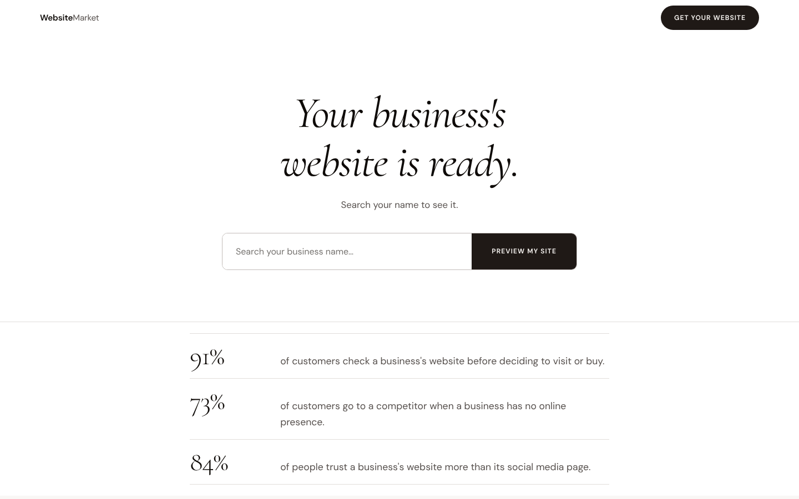
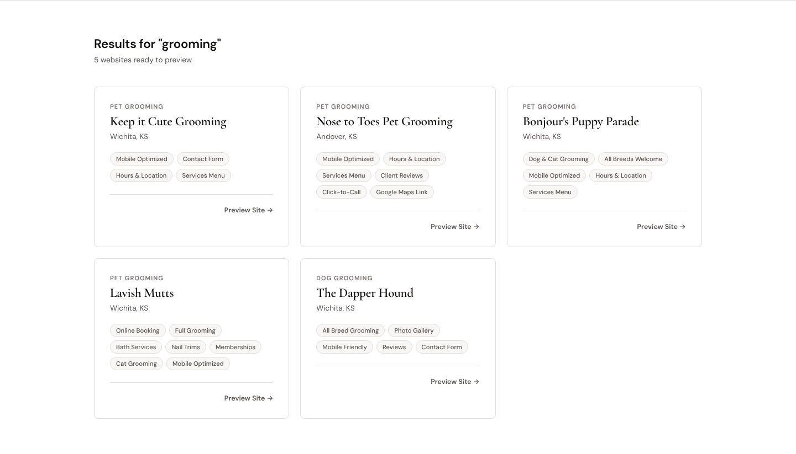
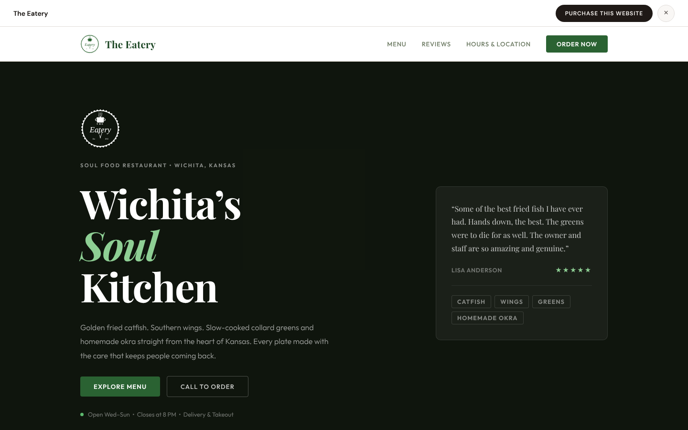
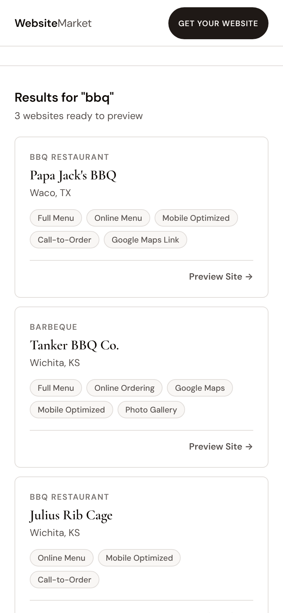
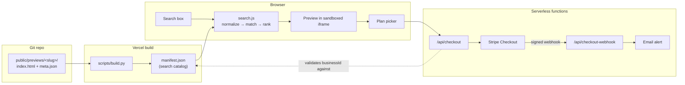

# Website Market

**Live:** [uswebsitemarket.com](https://uswebsitemarket.com)

Most of the work in selling a small business its first website is convincing the owner it will look good. Website Market skips that step. I build the site first, the owner searches their business name, sees the finished site running, and buys it.

The site has 16 live client sites for restaurants, pet groomers, gyms and other local businesses in Wichita, KS and Waco, TX. Payment runs through Stripe, and new sites go live with a `git push`.



| Ranked search | Live preview in a sandboxed iframe | Mobile |
|---|---|---|
|  |  |  |

## How it works



1. **Each site is a folder.** `public/previews/<slug>/` holds a self-contained website and a `meta.json` with the business's name, category, city and features. There's no database. The folder name (slug) is the single key that ties everything together: URL, catalog ID, Stripe `client_reference_id`, and the purchase email.
2. **The build step makes the search index.** On every deploy, `scripts/build.py` scans the folders and writes `manifest.json`, which is the only data the frontend reads. Adding a business means adding a folder and pushing; there's no admin backend or migration.
3. **Search runs in the browser.** The page loads the manifest once and searches it in memory (details below).
4. **The preview is the real site.** It loads in an `<iframe>` that can run scripts but has no access to the parent page (see [Security](#security)).
5. **Checkout** creates a Stripe subscription session with the $500 setup fee as a one-time line item. Stripe's webhook calls back, and the handler emails me exactly once per purchase.

## Search

The catalog is small enough to search in memory, but in-memory search still has to cope with how people actually type. `public/js/lib/search.js`:

- **Normalizes** text before matching. It lowercases, strips accents, and drops apostrophes, so `mamas` matches *Mama's*. Other punctuation becomes a space, so `barks an bubbles` matches *Barks-An-Bubbles*.
- **Matches every word of the query** (AND semantics), and each word can match any field. So `bbq waco` returns the one BBQ place in Waco.
- **Ranks** each query word by its best match: name beats category beats city, and a match at the start of a word beats one in the middle. Typing the start of a business's full name gives a bonus. Ties sort alphabetically, so results don't reshuffle between keystrokes.

The first version used a plain substring check, so `mamas kitchen` and `bbq waco` both returned nothing. Both cases are now covered by tests that run against the real catalog (`tests/unit/search.test.js`).

**At scale**, past a few thousand businesses, I'd move this server-side into an inverted index (OpenSearch or Postgres full-text). That would add typo tolerance (n-grams or edit distance), field boosting, and synonym expansion such as *barbecue* → *bbq*. The scoring function would stay the same shape.

## Security

- **Preview isolation.** Client sites run in `sandbox="allow-scripts allow-popups allow-popups-to-escape-sandbox allow-top-navigation-by-user-activation allow-forms"`. Without `allow-same-origin`, a preview gets an opaque origin, so it can't read the parent page's cookies or DOM, even though it's served from the same domain. Top-level navigation is only allowed on a real click, which keeps tap-to-call links working. A Playwright test checks that the parent page can't reach any preview's DOM.
- **Checkout validation.** `/api/checkout` only accepts businesses listed in the deployed manifest. The list is cached for 5 minutes, and the endpoint returns 503 if the manifest can't be loaded. Plan names are checked with `Object.hasOwn`, so `toString` or `__proto__` can't select a price.
- **Webhooks.** The Stripe signature is verified over the raw request body. Stripe can deliver the same event more than once, so duplicates are skipped two ways:
  - a set of recently seen event IDs, for retries that land on the same running instance;
  - a marker written to the subscription's metadata, which still works after a cold start.

  If the email fails, the handler returns 500 so Stripe retries.
- **Contact form.** Inputs are length-limited, control characters are stripped (blocking email header injection), a hidden honeypot field catches bots, and each IP gets 3 requests per 10 minutes.
- **No inline handlers.** Result cards carry their ID in a `data-` attribute and use event delegation, and all catalog text goes through one `escapeHtml`. Tests feed hostile names through the card renderer.
- **Deploy surface.** Only `public/` is served, and private `meta.json` fields such as the owner's email are left out of the public manifest.

## Tech stack

| Layer | Choice | Why |
|---|---|---|
| Frontend | HTML, CSS and native ES modules (no framework, no bundler) | Five pages and ~500 lines of JS; no build step needed for the client |
| Backend | Vercel serverless functions (Node, ESM) | Three endpoints with no state that needs to persist |
| Payments | Stripe Checkout + webhooks | Hosted payment page, so card data never touches this code |
| Build / tooling | Python (`build.py`, `add-to-market.py`) | Generates the search index and registers new sites |
| Email | Gmail via Nodemailer | Purchase, abandoned-checkout and demo-request alerts |
| Tests | `node:test`, `unittest`, Playwright | No test framework dependency for unit/API tests |
| CI | GitHub Actions | Unit, API, script and browser tests on every push and PR |

## Project layout

```
api/                     Serverless functions
  checkout.js            POST: create a Stripe Checkout session
  checkout-webhook.js    POST: Stripe events → purchase / abandoned-cart email
  contact.js             POST: demo-request form
  _lib/                  mailer, rate limiter, raw-body reader (not routes)
public/                  Everything Vercel serves
  index.html  purchase.html  all-builds.html  success.html  admin.html
  css/styles.css
  js/
    home.js  purchase.js  all-builds.js  success.js     one entry module per page
    lib/                 search, catalog, cards, checkout, preview modal, escaping
  previews/
    <slug>/              one client website + meta.json   (16 of these)
    manifest.json        generated catalog
scripts/
  build.py               meta.json files → manifest.json (runs on every deploy)
  add-to-market.py       register a new client site
tests/
  unit/                  search ranking, escaping, card rendering
  api/                   all three endpoints, with injected Stripe/email fakes
  python/                build + registration scripts, catalog integrity
  e2e/                   Playwright, desktop + mobile
```

Each API handler is built by a factory, for example `createCheckoutHandler({ getStripe, knownBusinessIds })`. Tests pass in fake Stripe and email clients, and the default export wires up the real ones. Webhook tests sign payloads with Stripe's real signing code rather than stubbing verification.

## Running locally

Requires Node 22+ and Python 3.11+.

```bash
npm install
npm run dev            # build the manifest and serve public/ at http://localhost:8080
```

Search, previews and the admin page work locally. Checkout and the contact form need the Vercel runtime (`vercel dev`) and these environment variables:

| Variable | Used by |
|---|---|
| `STRIPE_SECRET_KEY` | checkout, webhook |
| `STRIPE_WEBHOOK_SECRET` | webhook signature check |
| `GMAIL_APP_PASSWORD` | email alerts (skipped and logged if unset) |

## Testing

```bash
npm test               # 44 JS unit/API tests + 12 Python tests
npm run test:e2e       # 10 Playwright scenarios × desktop and mobile
```

The browser tests block all third-party requests, so they run offline and give the same result every time. They cover:

- search, keyboard navigation and focus return
- escaping of search queries
- checkout success and failure
- the demo form and its honeypot field
- the admin page
- loading all 16 client sites inside the sandbox without script errors

CI also fails if `manifest.json` is out of date.

## Adding a client site

```bash
python3 scripts/add-to-market.py --name "Mario's Pizza" --category "Italian Restaurant" \
    --city "Dallas, TX" --price 500 --features "Online Menu,Contact Form"
# copy the built site into public/previews/marios-pizza/, then
npm test && git add public/previews/marios-pizza && git commit -m "Add Mario's Pizza" && git push
```

## How it was built

I built this with [Claude Code](https://claude.com/claude-code) as a pair programmer, which is why many commits are co-authored. The client sites come from a repeatable agent workflow, defined in [`.claude/skills/new-webmarket-site/SKILL.md`](.claude/skills/new-webmarket-site/SKILL.md). It sets out:

- the required sections for each site;
- the sandbox constraints a site must work within;
- the register → test → push steps.

That workflow took the catalog from 0 to 16 production sites in eight days. The product idea, the choice of businesses, the pricing and the sales process are mine. The current pricing came out of market research on competing website-as-a-service offers.

## Known limitations

- The contact-form rate limit is kept in each server instance's memory. Vercel can run several instances that don't share memory, so this slows down a single abuser but isn't a global limit. A shared store such as Upstash Redis would make it one.
- Connecting a buyer's domain and handing over the site is still manual.
- Some client sites use stock photography until the owner supplies real photos.
